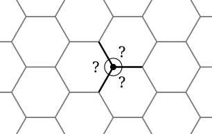

## Opener: the bees' corner

Honeybees store honey in wax cells with six sides, packed together into a comb. Look at any corner of the comb: exactly three cells meet there, never two and never four.

{width=75%}

Bees carry no protractors, yet every corner comes out the same.

- Guess: how big is each of the three angles at the marked corner?
- Squares can also be packed with no gaps, like floor tiles. So can triangles. Why might bees not use them?
- Could bees use five-sided cells instead?

By the end of this sheet you will be able to answer all three with certainty, not guesswork.







## Stretch

1. Two angles on a straight line are $x$ and $2x$. Find both angles.
2. Four angles around a point are $x$, $x$, $2x$ and $2x$. Find each angle.

## Back to the bees

3. Three equal angles fill the space around each corner of the comb. How big is each? Was your guess right?
4. Square tiles have 90° corners; equilateral triangles have 60° corners. How many of each meet at a point with no gaps? Show why.
5. A regular pentagon has 108° corners. Could bees build a comb from pentagons with no gaps? Explain.

*In 1999 the mathematician Thomas Hales proved that hexagons are the best choice of all: they divide a surface into equal cells using the least total wall, which for bees means the least wax.*
