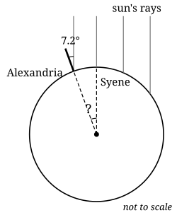





## Stretch

1. In Practice question 3, $48^\circ$ and $f$ are *co-interior* angles: between the parallels, on the same side of the transversal. Explain why co-interior angles always add up to $180^\circ$.
2. Two straight lines cross. One angle is $3x$ and the angle opposite it is $x + 40^\circ$. Find $x$ and all four angles.
3. A line crosses two other lines, making corresponding angles of $72^\circ$ and $74^\circ$. Are those two lines parallel? If not, on which side of the transversal do they meet?



## Transfer: measuring the Earth with a stick

Around 240 BC Eratosthenes, a scholar in Alexandria, Egypt, heard that at noon on midsummer's day the sun shone straight down a well in Syene, a town to the south. At the same moment in Alexandria, a vertical stick cast a shadow: the sun's rays met it at about 7.2°.

The sun is so far away that its rays arrive parallel.

{width=58%}

1. Explain why the angle at the Earth's centre is also 7.2°. Which pair of angles is it?
2. What fraction of a full turn is 7.2°?
3. Syene is about 800 km from Alexandria. Estimate the distance around the Earth.
