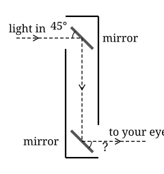

## Opener: build a periscope

A periscope lets you see over a wall or round a corner without being seen. Submarine crews used them to look above the waves. You can build one from a long carton, two small mirrors and tape.

{width=50%}

Cut a window near the top on one side and near the bottom on the other. Fix a mirror behind each window at 45°, so the two mirrors are parallel. A mirror bounces light off at the same angle it arrives, like a ball off a wall.

- Look through the bottom window. Is the view upright? Which way are you looking?
- Tilt one mirror a little. What happens to the view?
- Why must the mirrors be parallel?







## Stretch

1. In Practice question 3, $48^\circ$ and $f$ are *co-interior* angles: between the parallels, on the same side of the transversal. Explain why co-interior angles always add up to $180^\circ$.
2. Two straight lines cross. One angle is $3x$ and the angle opposite it is $x + 40^\circ$. Find $x$ and all four angles.

## Back to the periscope

3. Light arrives horizontally and meets the top mirror at 45°. It leaves at the same angle. Through what angle has it turned?
4. Between the mirrors, the light crosses both of them. Use alternate angles to find the angle marked ? at the bottom mirror, then show the light leaves travelling in the same direction it came in.
5. If the mirrors were not parallel, which step of your answer to question 4 would fail? What would happen to the view?
